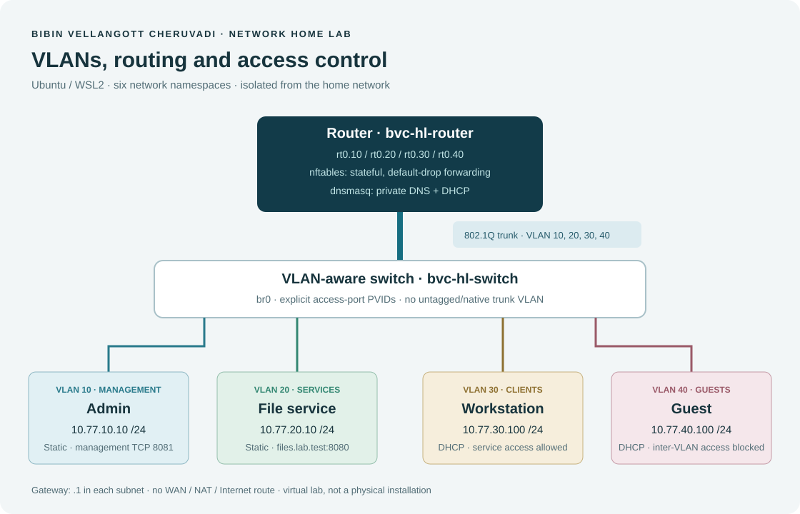

# Network Home Lab

Four VLANs, a router-on-a-stick trunk, DHCP, private DNS and inter-VLAN firewall rules.

The topology runs inside Linux network namespaces on Ubuntu/WSL2. The switch, router and four endpoints have separate network stacks; all links are virtual.



## Address plan

| VLAN | Use | Subnet | Endpoint | Gateway |
|---|---|---|---|---|
| 10 | Management | 10.77.10.0/24 | Admin: 10.77.10.10 | 10.77.10.1 |
| 20 | Services | 10.77.20.0/24 | File service: 10.77.20.10 | 10.77.20.1 |
| 30 | Clients | 10.77.30.0/24 | DHCP reservation: 10.77.30.100 | 10.77.30.1 |
| 40 | Guests | 10.77.40.0/24 | DHCP reservation: 10.77.40.100 | 10.77.40.1 |

DHCP pools are `.100–.150` in VLANs 30 and 40. DNS and the default gateway are supplied by DHCP. The router answers `files.lab.test → 10.77.20.10` and `management.lab.test → 10.77.10.10` without forwarding queries to the Internet.

## What is configured

- A VLAN-aware Linux bridge with four untagged access ports.
- One 802.1Q trunk carrying VLANs 10, 20, 30 and 40. No native/untagged VLAN on the trunk.
- Four router subinterfaces, one gateway per VLAN and IPv4 forwarding inside the router namespace.
- DHCP and DNS with dnsmasq; leases acquired with BusyBox `udhcpc`.
- A default-drop nftables forwarding policy, stateful return traffic and source-prefix checks.
- TCP service probes, ICMP checks, DNS queries, firewall counters and a packet capture on the trunk.
- An access-port shutdown/recovery drill with actual diagnostic output.

The two tiny HTTP pages are service targets for connectivity tests. They do not provide an application interface or contain real files or credentials.

## Traffic policy

| Source | Destination | Result |
|---|---|---|
| Admin VLAN 10 | Other lab VLANs | Allowed |
| Client VLAN 30 | File service VLAN 20, TCP 8080 | Allowed |
| Client VLAN 30 | Service VLAN 20, ICMP | Allowed |
| Clients and guests | Their router, DNS/DHCP | Allowed |
| Client VLAN 30 | Management VLAN 10 | Blocked |
| Guest VLAN 40 | Other VLANs | Blocked |
| Service VLAN 20 | New connections towards clients | Blocked |
| Established/related return traffic | Original source | Allowed |

There is no WAN interface, NAT or Internet default route. IPv6 forwarding is outside this exercise. Guest isolation is between VLANs; there is only one endpoint per VLAN, so this does not test guest-to-guest isolation on the same access network.

## Run

Use a Linux VM or WSL2 with root access. The checked environment was **Ubuntu 24.04.3 LTS, WSL2 kernel 6.6.87.2**. Required commands: `ip`, `bridge`, `nft`, `dnsmasq`, `busybox` with `udhcpc`/`httpd`/`nslookup`, `curl`, `ping`, `tcpdump`, `timeout` and `sysctl`.

On a dedicated Ubuntu lab VM, the usual packages are:

```bash
sudo apt update
sudo apt install iproute2 nftables dnsmasq-base busybox-static curl iputils-ping tcpdump
```

The recorded run used official Ubuntu package binaries unpacked into an ignored local `tools/` directory. No host DNS/DHCP or firewall service was installed or enabled for that run. If you use the same arrangement, set `HLAB_TOOLS` to that directory before running the commands below.

```bash
chmod +x lab.sh scripts/*.sh
sudo ./lab.sh up
sudo ./lab.sh verify
sudo ./lab.sh show
sudo ./scripts/fault-drill.sh
sudo ./lab.sh down
```

To record the full exercise and clean up afterwards in one Linux session:

```bash
sudo ./scripts/record-run.sh
```

The recorder checks that the trunk capture contains DHCP, private DNS and service TCP traffic before saving it as evidence.

With local unpacked tools, use `sudo env HLAB_TOOLS="$PWD/tools" ./lab.sh up` and the same prefix for `verify` and `show`. The fault drill uses the system `ip` and `curl` commands.

`up` refuses existing lab namespace names instead of overwriting them. `down` checks its ownership record and removes only this lab's namespaces and their processes. It does not flush the host firewall, change host routes, move physical interfaces or edit the host DNS configuration. Keep `run/` until cleanup has completed. The lab is temporary and must be recreated after a reboot.

## Checks and evidence

**17 connectivity/policy checks passed** on 28 October 2026. The access-port fault drill also passed. The recorded outputs are linked below.

- [Connectivity test transcript](evidence/connectivity.txt)
- [VLAN, routes, firewall counters and leases](evidence/network-state.txt)
- [Access-port fault and recovery](evidence/fault-drill.txt)
- [Trunk capture](evidence/validation.pcap) and [decoded packet excerpt](evidence/packet-excerpt.txt)
- [Verification notes](docs/verification.md)

Expected timeouts in the transcript are the blocked cases. Each blocked service has a successful positive control, so an offline service is not counted as proof of a firewall rule. The tagged-VLAN check attempts VLAN 30 from the guest access port and confirms that the wrong tag is filtered.

## Useful commands

```bash
sudo ip netns exec bvc-hl-switch bridge vlan show
sudo ip -n bvc-hl-router -br address
sudo ip -n bvc-hl-router route
sudo ip netns exec bvc-hl-router nft list ruleset
sudo ip netns exec bvc-hl-client busybox nslookup files.lab.test 10.77.30.1
sudo ip netns exec bvc-hl-client curl --noproxy '*' http://10.77.20.10:8080
sudo ip netns exec bvc-hl-guest curl --noproxy '*' --connect-timeout 1 http://10.77.20.10:8080
sudo tcpdump -nn -e -r evidence/validation.pcap
```

If the tools were unpacked locally, add their directories to `PATH`/`LD_LIBRARY_PATH` or use the wrapper's `show` command. [Troubleshooting notes](docs/troubleshooting.md) cover the port-shutdown exercise and the order of checks.

## Files

`config/` contains the router firewall and DNS/DHCP configuration. `lab.sh` assembles the topology. `scripts/` contains lease handling, connectivity checks and the fault drill. `evidence/` contains the recorded lab output; `run/` is local state and is ignored by Git.

## Limites / résumé en français

Home lab réseau virtuel : segmentation en quatre VLANs, trunk 802.1Q, routage inter-VLAN, DHCP/DNS, filtrage nftables, capture de paquets et dépannage d’un port d’accès. Exécuté et vérifié sous Ubuntu/WSL2.

MIT License — Bibin Vellangott Cheruvadi.

### References

- [Linux network namespaces](https://man7.org/linux/man-pages/man8/ip-netns.8.html)
- [Linux bridge VLAN configuration](https://man7.org/linux/man-pages/man8/bridge.8.html)
- [nftables base chains and policies](https://wiki.nftables.org/wiki-nftables/index.php/Configuring_chains)
- [dnsmasq configuration manual](https://thekelleys.org.uk/dnsmasq/docs/dnsmasq-man.html)

## Related infrastructure project

[Kubernetes DevOps lab](projects/kubernetes-devops-lab/) — local Docker/K3s, PostgreSQL migration, WAF and deployment checks. Work in progress: 14 live checks passed; a network-policy probe failed and later scenarios remain unverified. See the project README and recorded evidence.
