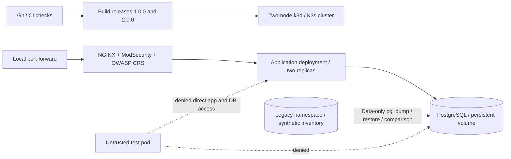

# Kubernetes DevOps Infrastructure Lab

A local deployment and migration exercise for systems/network and DevOps work. The application is deliberately small: a read-only view of three synthetic inventory records. The infrastructure, release pipeline and verification are the project.

No cloud account or paid service is used. This is a personal lab, not an employer production deployment.

## Recorded status — 29 October 2026

**Work in progress.** The recorded local run passed 12 unit/manifest tests and 14 live checks, then stopped at a network-policy probe with `Connection refused`. That probe did not establish the expected timeout result. The remaining network-policy, rollout, rollback and recovery checks have not been verified. The temporary cluster was removed after the run.

The sections below describe the implementation and intended checks, not a claim that every scenario passed. No successful remote CI run is claimed.

## Architecture



The entry point is bound to `127.0.0.1:19880`. The app and database have ClusterIP services only. NetworkPolicy allows WAF → app → database and DNS, with a default-deny policy. K3s supplies the policy controller; the live checks test actual connectivity rather than treating an applied YAML resource as proof.

## Requirements

- Linux amd64 or Ubuntu under WSL2, Python 3.12+, Bash and curl.
- A running Linux Docker Engine accessible from the current shell.
- Approximately 8 GB RAM and 10 GB free disk recommended for the complete two-node run and image builds.
- Internet access for official tools, images and the pinned Python dependency.
- No existing cluster named `bvc-devops`. The pipeline refuses to overwrite one.

Install the pinned k3d and kubectl tools if needed:

```bash
bash scripts/tools.sh
export PATH="$PWD/.runtime/tools:$PATH"
```

The helper verifies their published SHA-256 checksums. It does not install or start a host Docker service. On other architectures, use the official installation instructions in `docs/sources.md`.

## Run

```bash
bash scripts/check.sh       # unit and manifest checks, no cluster
bash scripts/pipeline.sh    # full build / deploy / migrate / verify / cleanup
```

`make check`, `make tools`, `make verify` and `make clean` are optional shortcuts.

The pipeline pulls the base images, records immutable digests in `evidence/images.lock.json`, builds two app releases, creates a server and an agent, deploys the legacy and target namespaces, migrates the synthetic database and runs the integration checks. It exports a dedicated kubeconfig under the ignored `.runtime/` folder; it does not change the default kubeconfig context.

Keep the cluster temporarily for inspection:

```bash
KEEP_LAB=1 bash scripts/pipeline.sh
export KUBECONFIG="$PWD/.runtime/kubeconfig"
kubectl -n bvc-platform get pods,svc,pvc,networkpolicy
curl http://127.0.0.1:19880/
bash scripts/cleanup.sh
```

By default the cluster is removed on success or failure. Cleanup requires the matching local ownership record and deletes only the named cluster. It does not run a global Docker prune.

## Implemented checks (see recorded status above)

- Unit checks: health versus readiness, read-only endpoints, HTML escaping, error sanitisation, metrics, release reporting, probes/resource limits and manifests without embedded secrets.
- Migration: legacy has three records, target starts empty, a data-only PostgreSQL export is restored, and ordered data is compared before retiring the legacy namespace.
- Security: a read-only database role; non-root app execution; read-only app filesystem; no mounted workload API token; observer RBAC denies secret access.
- WAF: harmless SQL-injection and XSS **test strings** are blocked while ordinary requests succeed. This does not demonstrate an exploitable application vulnerability or comprehensive attack coverage.
- Networking: the intended check requires DNS and WAF access, with direct app/database access denied. This run stopped before completing that check. Positive controls prevent an offline service from being counted as proof of blocking.
- Releases: update from version 1.0.0 to 2.0.0, sample HTTP requests during rollout, inject a readiness failure and roll back the failed revision.
- Recovery: replace an application pod; replace the PostgreSQL pod and verify that the migrated records remain on the persistent volume.
- Operations: metrics endpoint, structured logs, bounded CPU/memory settings, recorded resources and test results.

See the actual run evidence in `evidence/`. Counts and outcomes belong to the recorded run, not a generic guarantee.

## Kubernetes resources

`scripts/render.py` generates native Kubernetes JSON resources, which Kubernetes accepts alongside YAML. Inspect a manifest before running it:

```bash
python3 scripts/render.py > /tmp/bvc-platform-review.json
```

The resources include Deployments, StatefulSet/PVC, Services, ConfigMap, service accounts, observer Role/RoleBinding, PodDisruptionBudget and NetworkPolicies. Secret values are generated per run and passed separately; they are never embedded in the manifests or committed.

The PostgreSQL process needs a writable data volume. The official CRS image also needs writable paths, so its root filesystem is not claimed to be read-only. The app root filesystem is read-only and is tested as such.

## CI

The GitHub Actions workflow runs the same checks and local-cluster pipeline on a Linux runner. It needs no cloud credentials. Evidence is uploaded even when a run fails. A workflow file being present is **not** proof that a remote run has succeeded; use the repository Actions page and the recorded workflow run separately.

## Limits

- One physical host, one WAF replica and one database instance: no production high-availability or disaster-recovery SLA.
- No physical server, hypervisor or VM migration is performed here. Proxmox/VMware work belongs to separate practical projects.
- The database operation is a small logical migration of synthetic data, not an enterprise cutover or production backup service.
- The demo app has no user login and must stay local. The WAF does not replace authentication, patching, TLS or a security review.
- No image/dependency vulnerability scanner is included in this version; do not describe the WAF checks as a vulnerability scan.
- No cloud deployment, industrial OT system or team Agile experience is implied.

## Résumé en français

Laboratoire personnel Kubernetes/DevOps en local : cluster K3s à deux nœuds avec k3d, construction d'images Docker, déploiements automatisés, migration logique PostgreSQL, WAF NGINX/ModSecurity avec OWASP CRS, contrôle des flux par NetworkPolicy et vérifications RBAC. Scénarios prévus : mise à jour progressive, échec de disponibilité, retour arrière et remplacement de pods. Ces derniers restent à valider. Le dernier essai a validé 14 contrôles en environnement réel avant un échec de test réseau. Les données sont fictives.

MIT — Copyright 2026 Bibin Vellangott Cheruvadi.
